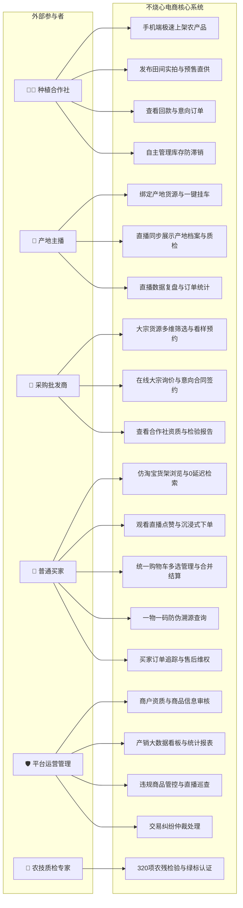

# “不烧心”农产品直播电商产销对接平台 - 软件需求规格说明书 (SRS)

**项目名称**：基于 SpringBoot+Vue 的“不烧心”农产品直播电商产销对接平台  
**品牌标语**：好产品，不烧心  
**课程名称**：软件工程导论课程设计  
**文档标准**：遵循 IEEE Std 830-1998 规范  
**文档版本**：V2.0  
**编制日期**：2026年11月  

---

## 1. 引言 (Introduction)

### 1.1 编写目的
本文档是“基于 SpringBoot+Vue 的‘不烧心’农产品直播电商产销对接平台（标语：好产品，不烧心）”的软件需求规格说明书（Software Requirements Specification, SRS）。文档详尽阐述了系统的功能性需求、非功能性需求、接口要求、用户角色模型（覆盖六大角色）以及外部约束条件。本文档作为系统设计、编码实现、系统测试以及最终验收的唯一基准文件，供项目开发小组、指导教师及测试评估人员阅读与遵循。

### 1.2 项目背景与范围
本项目旨在解决我国农产品“销路分散”、“产销信息脱节”以及“产地货源真实性难核验”的三大核心痛点。平台以“**好产品，不烧心**”为立台之本，借鉴淘宝网的货架电商排版、直播互动以及大宗批发交易机制，依托现代 Web 体系，为六类用户（普通买家、种植合作社、产地主播、采购批发商、平台运营管理、农技质检专家）提供集“田间直采、大宗批发、全真直播、一物一码溯源、统一购物车、专业农残质检”于一体的综合数字化电商产销对接解决方案。

### 1.3 参考文献
1. GB/T 8567-2006《计算机软件文档编制规范》
2. IEEE Std 830-1998《IEEE Recommended Practice for Software Requirements Specifications》
3. 《中华人民共和国电子商务法》
4. 张海藩, 牟永敏. 《软件工程导论》（第6版）. 清华大学出版社.

---

## 2. 任务概述 (Overall Description)

### 2.1 产品视角与定位
本平台属于典型的 B2B2C + 直播导流 + 第三方权威质检的双边撮合交易平台：
- **B端上游（生产）**：种植合作社作为源头供货方，管理种植排期与地头直发；
- **B端中游（营销/流通）**：产地主播提供场景化直播信任背书与带货销售；采购批发商进行大宗采购与长期履约；
- **C端下游（零售消费）**：普通买家享受“原产地平价好物”、卡通亲和交互与统一购物车结算体验；
- **质检端（品质背书）**：农技质检专家对地标样品与农残检测进行严谨背书，签发“好产品，不烧心”权威绿标；
- **平台中枢**：平台运营管理员把控资质、风控商品、监管直播与纠纷仲裁。

### 2.2 用户特征与角色画像（六大核心角色）

全平台所有用户**默认均采用现代矢量卡通头像（DiceBear 体系）**，兼顾童趣与现代感，各角色特征如下：

| 角色编号 | 用户角色名称 | 默认卡通头像与标识 | 典型使用场景与特点 |
| :--- | :--- | :--- | :--- |
| **ROLE_CONSUMER** | **普通买家** | 萌系吃客小淘 (FelixBuyer) | 追求绿色天然、性价比的终端个人买家。习惯仿淘宝网购体验（商品浏览、多选购物车结算、看直播点赞抢优惠、实时物流追踪）。 |
| **ROLE_COOP** | **种植合作社** | 憨厚老农大叔 (UncleFarm) | 位于农业生产一线，多使用智能手机，操作追求简单直观。核心需求是发布当季37款样品排期、管理田间档案、接洽大宗询价。 |
| **ROLE_ANCHOR** | **产地主播** | 阳光青年主播 (SunnyAnchor) | 扎根田间地头，熟悉移动直播。需要快速挑选优质产地货源并一键挂载到直播小黄车，实时展示采摘场景和检验报告。 |
| **ROLE_WHOLESALE** | **采购批发商** | 精英采购经理 (ManagerZhang) | 餐饮连锁、商超或二级批发市场采购代表。需要按吨级大批量直采，对产地真实度、检测资质、供货周期与账期极度敏感。 |
| **ROLE_ADMIN** | **平台运营管理** | 科技管家机甲 (SuperAdmin) | 平台运营治理人员，使用电脑端大屏。负责商户认证、商品质量抽查、违规直播封禁、产销大数据监控分析与纠纷调解。 |
| **ROLE_EXPERT** | **农技质检专家** | 严谨质检博士 (QualityExpert) | 农业科学院/质检院品控代表。负责地标样品专项筛查、320项农残零检出巡检抽检与签发“好产品，不烧心”品质认证证书。 |

### 2.3 运行环境与约束
- **客户端**：支持主流现代浏览器（Chrome 100+、Edge、Safari、手机端移动浏览器）。
- **服务端**：JDK 21 LTS, Spring Boot 3.x, MyBatis-Plus, H2/MySQL 8.0。
- **界面体验约束**：
  * **品牌专属 Logo**：绿色心形与生态叶芽造型徽标，标语“好产品，不烧心”；
  * **商品样品丰富度**：货架展示 37 款地标优质农产品样品（涵盖水果 12 款、蔬菜 7 款、粮油 5 款、滋补 5 款、禽畜 4 款、水产 4 款）；
  * **统一购物车页面**：具备全选反选、数量加减、运费减免与底部吸顶统一结算功能；
  * **主色调与视觉**：遵循经典淘宝橙（#FF5000 / #FF4400）与生态绿（#2ED573 / #10AC84）完美融合，支持大屏与手机端响应式自适应。

---

## 3. 系统用例建模 (Use Case Modeling)

### 3.1 总体用例图 (Mermaid UML)


    A5 --> UC17
    A5 --> UC18
```

---

## 4. 功能性需求详述 (Functional Requirements)

### 4.1 种植合作社模块 (Cooperative Management)
- **FR-1.1 手机端极速上架**：
  - 支持移动端上传，必填产地地理位置（GPS/省市区）、预估总产量（吨/斤）、上市时间周期、批发阶梯价与零售零售建议价；
  - 支持多图（田间实拍、果实实拍）和视频上传；
  - 支持选择销售模式：普通现货、田间预售、产地直供直发。
- **FR-1.2 预售与直供活动发起**：
  - 设定预售定金比例、预计发货日期，实现提前锁量锁客，防止丰收期无序抛售造成滞销。
- **FR-1.3 采销意向与回款管理**：
  - 实时查看采购批发商提交的意向订单；
  - 实时查看订单结算对账单、已入账资金、待结算账款与物流发货履约进度。
- **FR-1.4 动态库存调控**：
  - 可自主针对大宗批发通道与零售直播通道划分配额，根据采摘进度随时更新可供货库存。

### 4.2 产地主播模块 (Anchor Live Streaming)
- **FR-2.1 货源绑定与带货选品池**：
  - 浏览已认证合作社的开放直供货架，申请绑定分销带货；
  - 直播间后台“一键挂载”至直播货架（购物车小黄车）。
- **FR-2.2 产地档案与质检报告联动**：
  - 直播过程中，主播可点击“讲解商品”，客户端画面悬浮展示该农产品的土壤环境指标、有机认证资质、第三方农残检测合格报告及采摘现场全景。
- **FR-2.3 互动与订单实时看板**：
  - 直播中实时接收观众互动弹幕、咨询提醒；
  - 实时展示本场成交件数、成交金额（GMV）、转化率，下播后生成单品成交复盘报告。

### 4.3 采购批发商模块 (Wholesale Purchasing)
- **FR-3.1 大宗货源精准筛选**：
  - 支持多维度组合检索：品类（果蔬/粮油/畜禽/水产/药材）、产地行政区划、采收上市时间跨度、最小起订量（MOQ）。
- **FR-3.2 在线多轮询价与磋商**：
  - 批发商可就意向采购吨数、期望包装规格、冷链运输条款提交询价单；
  - 合作社在线确认/还价，达成一致后一键生成《电子意向采购合同草案》。
- **FR-3.3 资质验真与预约看货**：
  - 在线查阅合作社营业执照、绿色食品认证、出厂检测原件高清扫描件；
  - 提交预约实地看货考察申请，录入到访人数、预估日期，合作社确认后下发接待码。

### 4.4 普通消费者模块 (Consumer Retailing)
- **FR-4.1 仿淘宝货架电商体验**：
  - 顶部搜索框、热搜词、分类轮播横幅、双列流体商品卡片；
  - 商品详情页包含：多图轮播、拼团/直降标签、产地直发标识、累计评价、一键加入购物车或立即购买。
- **FR-4.2 直播边看边买**：
  - 沉浸式竖屏/横屏直播画面，底部悬浮商品橱窗，支持小窗画中画继续播放；
  - 支持弹幕发送、点赞飘心与直播专属优惠券领取。
- **FR-4.3 溯源防伪与产地收藏**：
  - 每一件商品附带独立溯源码/批次码，输入即可查看从种植播种、施肥灌溉、采摘质检到包装发货全时间轴；
  - 消费者可一键“收藏/关注该产地合作社”，并在合作社上架当季新品时收到系统站内消息推送。
- **FR-4.4 订单结算与售后保障**：
  - 购物车合并结算、收货地址管理；
  - 支持 7 天无理由售后申请（针对损坏烂果提供“极速拍照退款”通道）。

### 4.5 平台运营管理模块 (Platform Administration)
- **FR-5.1 准入资质审核**：
  - 合作社经营许可证审核、主播实名认证审核、上架农产品抽检合规性审查。
- **FR-5.2 违规管控与直播安全巡查**：
  - 关键词违规监控（违禁农药宣传、假冒地标等），支持一键下架商品或关闭直播间推流。
- **FR-5.3 产销大数据决策看板**：
  - 聚合全平台实时销售总额、各省份农产品供需热力分布图、热销品类占比饼图、价格波动趋势折线图。
- **FR-5.4 纠纷调解与仲裁**：
  - 针对大宗货损、消费者质量纠纷，管理员介入双方举证环节，依据证据执行强制退款或仲裁结案。

---

## 5. 核心业务用例规约 (Use Case Specifications)

### 用例 1：大宗货源在线询价与签约 (UC-09)
- **参与角色**：采购批发商、种植合作社
- **前置条件**：批发商已实名认证并登录平台，合作社商品状态为“在售/直供”。
- **基本事件流**：
  1. 批发商在大宗采购专区筛选目标农产品，点击【发起大宗询价】；
  2. 填写采购意向吨数（如 20 吨）、期望到货时间、期望单价（如 3.2元/斤）及包装冷链需求并提交；
  3. 系统生成处于“待合作社确认”状态的询价单，并通过站内消息即时推送至合作社负责人；
  4. 合作社手机端收到提醒，查看询价详情，可选择【接受报价】或【修改报价】回复；
  5. 双方达成一致后，系统自动依据约定条款套用法律模版生成《农产品大宗产销意向采购合同》；
  6. 双方使用安全验证密码完成电子签名，合同生效，状态转为“待履约定金支付”。
- **后置条件**：系统锁定对应大宗库存，更新合作社意向订单列表。

### 用例 2：直播带货与画中画联动购买 (UC-12)
- **参与角色**：普通消费者、产地主播
- **前置条件**：主播已开播并挂载商品列表，消费者已进入直播间。
- **基本事件流**：
  1. 主播在直播控制台点击【讲解此商品】；
  2. 消费者直播间界面弹出该商品卡片，包含产地档案与优惠直降价；
  3. 消费者点击【立即抢购】，若消费者切换至其他界面，直播自动缩小为右下角画中画窗口继续播音；
  4. 弹出仿淘宝订单确认弹窗，选择收货地址与支付方式；
  5. 消费者确认支付，系统扣减对应库存，下发订单发货通知至合作社。
- **异常事件流**：若库存被抢空，系统提示“手慢了，该批次产地好物已被抢空”，恢复原直播状态。

---

## 6. 非功能性需求 (Non-Functional Requirements)

### 6.1 性能需求 (Performance)
- **系统响应时间**：常规页面（商品浏览、分类查询）首屏加载时间在正常网络环境下不超过 1.5 秒；数据查询接口平均耗时小于 200ms。
- **高并发承载力**：直播间秒杀场景下，核心库存扣减接口单机 QPS 支持 ≥ 1000，且通过乐观锁与缓存机制保证 100% 不超卖。
- **实时消息时延**：WebSocket 弹幕及订单变动推送网络时延控制在 300ms 以内。

### 6.2 安全性需求 (Security)
- **敏感数据加密存储**：所有用户密码均经过 Spring Security BCrypt 强哈希算法（带动态加盐）加密存储；
- **传输安全**：API 交互采用 HTTPS 协议，鉴权采用无状态 JWT (JSON Web Token)，包含过期失效与权限签名防伪；
- **防重放与防刷限流**：针对秒杀与大宗提交接口实施 Redis 令牌桶限流与分布式防刷保护。

### 6.3 易用性与跨端适配 (Usability & Responsiveness)
- **终端自适应**：系统采用响应式 Flex/Grid 栅格设计，确保在 PC 大屏（1920×1080）与智能手机端（iOS/Android 竖屏 375px~430px 视口）均能自适应呈现最佳排版；
- **仿淘宝视觉范式**：遵循电商行业标准的“淘宝红/橙”视觉识别体系，减少用户认知负荷。

### 6.4 可靠性与可维护性 (Reliability & Maintainability)
- 软件具备清晰的错误拦截体系（全局 ExceptionHandler），为前端提供统一规范的 `Result<T>` JSON 错误码反馈；
- 系统平均无故障运行时间 (MTBF) 达到 99.9% 以上，数据库每日凌晨执行自动化逻辑快照备份。
