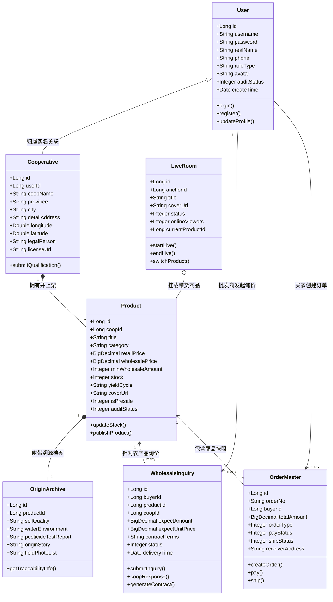
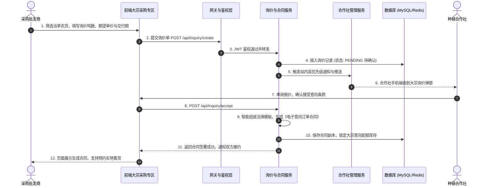
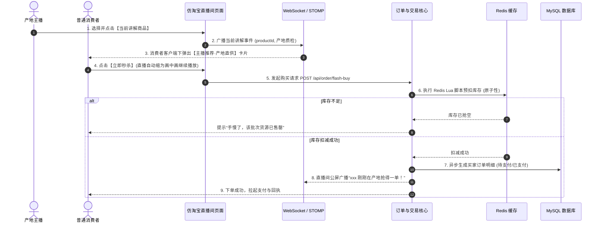
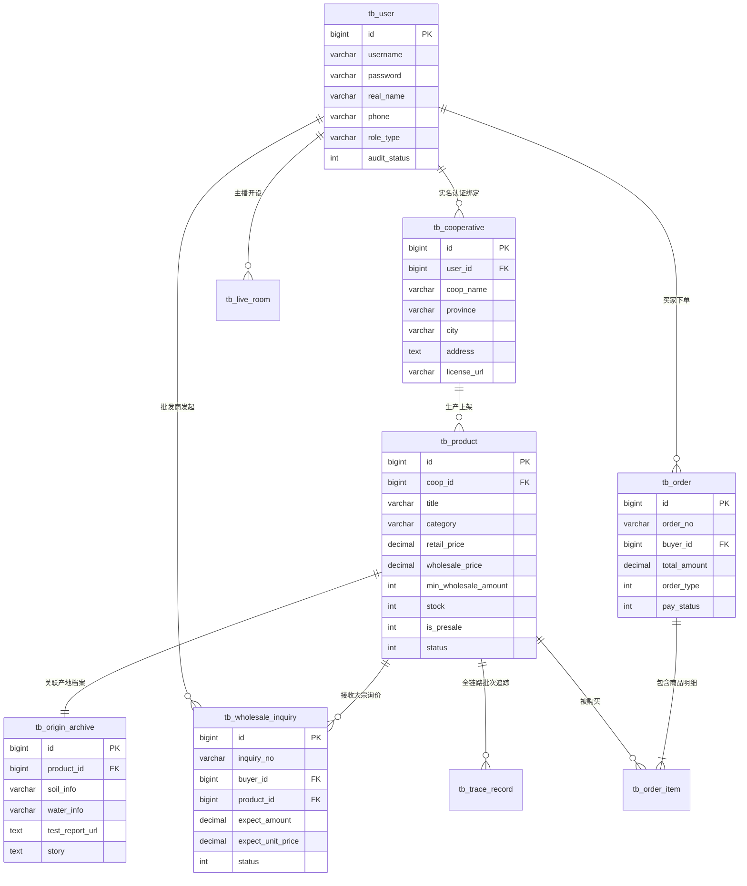

# “不烧心”农产品直播电商产销对接平台 - 系统架构与详细设计说明书

**项目名称**：基于 SpringBoot+Vue 的“不烧心”农产品直播电商产销对接平台  
**品牌标语**：好产品，不烧心  
**课程名称**：软件工程导论课程设计  
**设计方法**：面向对象分析与设计方法 (OOAD)  
**文档版本**：V2.0  
**编制日期**：2026年11月  

---

## 1. 系统总体架构设计

### 1.1 总体架构模型
本项目严格遵循经典的分层体系架构（Layered Architecture）与前后端分离（B/S）模式，确立“**好产品，不烧心**”为核心架构理念，整体系统分为五大层次：终端展示层、API网关与安全层、业务逻辑服务层、数据访问与持久层、外部支撑基础设施层。

```mermaid
flowchart TD
    subgraph ClientLayer["1. 终端展示层 (Vue 3 + Vite + Element Plus)"]
        UI_PC["PC端 仿淘宝综合商城门户 (不烧心Logo/标语/37款样品)"]
        UI_MOBILE["手机端 移动响应式双列货架与TabBar"]
        UI_CART["统一购物车管理中心 (Cart View/多选/合并结算)"]
        UI_LIVE["直播互动带货间 (画中画/弹幕/心形动效/货架)"]
        UI_B2B["大宗产销批发直采中心 (在线询价/意向合同)"]
        UI_DASH["运营大数据监控决策看板与农技质检工作台"]
    end

    subgraph SecurityLayer["2. 接入与安全网关层 (Spring Security + JWT)"]
        GW_FILTER["JWT Token 无状态认证过滤器"]
        GW_CORS["跨域 CORS 协调处理"]
        GW_RATE["Redis 令牌桶接口防刷限流"]
        GW_WS["WebSocket STOMP 实时握手管道"]
    end

    subgraph ServiceLayer["3. 核心业务逻辑层 (Spring Boot 3.x Services)"]
        SVC_USER["用户与六大角色鉴权服务 (UserService)"]
        SVC_PROD["农产品与产地档案管理服务 (ProductService - 37款地标农品)"]
        SVC_LIVE["直播间调度与货架联动服务 (LiveRoomService)"]
        SVC_INQUIRY["大宗询价与意向合同履约服务 (InquiryService)"]
        SVC_ORDER["交易订单结算与库存防超卖服务 (OrderService)"]
        SVC_TRACE["全链路数字化农产品溯源服务 (TraceService)"]
        SVC_EXPERT["农技专家320项质检与绿标签发服务 (ExpertService)"]
        SVC_AUDIT["资质审核与风控治理服务 (AuditService)"]
    end

    subgraph DataLayer["4. 数据持久与缓存层 (Persistence & Cache)"]
        ORM["MyBatis-Plus 3.5+ ORM 引擎"]
        DB_MYSQL[("MySQL 8.0 核心关系数据库\n(支持ACID强事务/订单/合同)")]
        CACHE_REDIS[("Redis 7.0 内存高速缓存\n(热点库存/Token/弹幕发布订阅)")]
    end

    subgraph InfraLayer["5. 基础设施与对象存储"]
        OSS["田间大图 / 质检报告 / 短视频存储 (Local / OSS)"]
        LOG["Logback 结构化运维安全审计日志"]
    end

    ClientLayer --> SecurityLayer
    SecurityLayer --> ServiceLayer
    ServiceLayer --> DataLayer
    DataLayer --> InfraLayer
```

### 1.2 仿淘宝视觉交互设计规范
- **色彩规范**：
  - 主基调：经典淘宝活力橙（`#FF5000` / `#FF4400`），传达电商热情与丰收气息；
  - 辅助色：生态健康绿（`#2BB673`，用于产地直供、质检合格、有机溯源标识）；
  - 警示色：价格与直降标签（`#E60012`），状态预警黄（`#FA8C16`）；
  - 背景色：干净柔和的高级底色（`#F4F5F7`），内容区纯白（`#FFFFFF`）。
- **组件结构**：
  - 仿淘宝“双列流体瀑布流”商品卡片，带“产地直供”、“首单立减”、“农残检测已核验”立体徽标；
  - 吸顶动态检索框，提供“寻产地”、“找大宗货源”、“看田间直播”多维快速切片；
  - 直播间支持点击商品卡片时不打断视频流，画中画悬浮窗平滑下沉。

---

## 2. 面向对象静态模型设计 (Static UML Model)

### 2.1 核心领域类图 (Class Diagram)

---

## 3. 面向对象动态模型设计 (Dynamic UML Model)

### 3.1 时序图一：采购批发商大宗询价与意向合同生成

### 3.2 时序图二：产地主播开播带货与消费者直播画中画抢购

---

## 4. 数据库详细设计 (Database Schema Design)

系统采用 MySQL 8.0 进行数据持久化，统一采用 UTF-8MB4 字符集。表名统一添加 `tb_` 前缀。

### 4.1 概念模型 E-R 图 (Mermaid ER)

### 4.2 核心数据表结构字典

#### 1. 用户核心表 (`tb_user`)
| 字段名 | 数据类型 | 允许空 | 默认值 | 说明与约束 |
| :--- | :--- | :---: | :---: | :--- |
| `id` | BIGINT | 否 | 自增 | 主键 ID |
| `username` | VARCHAR(50) | 否 | - | 登录账号/用户名 (唯一索引 `uk_username`) |
| `password` | VARCHAR(120) | 否 | - | BCrypt 动态密文 |
| `real_name` | VARCHAR(50) | 否 | - | 实名姓名/企业名称 |
| `phone` | VARCHAR(20) | 否 | - | 联系手机号码 (唯一索引 `uk_phone`) |
| `role_type` | VARCHAR(20) | 否 | 'CONSUMER' | 角色：COOP(合作社)/ANCHOR(主播)/WHOLESALE(批发商)/CONSUMER(消费者)/ADMIN(管理员) |
| `avatar` | VARCHAR(255) | 是 | - | 头像 URL |
| `audit_status` | INT | 否 | 1 | 认证状态：0-待审核, 1-已认证, 2-驳回 |
| `create_time` | DATETIME | 否 | CURRENT_TIMESTAMP | 注册时间 |

#### 2. 种植合作社资质档案表 (`tb_cooperative`)
| 字段名 | 数据类型 | 允许空 | 默认值 | 说明与约束 |
| :--- | :--- | :---: | :---: | :--- |
| `id` | BIGINT | 否 | 自增 | 合作社主键 ID |
| `user_id` | BIGINT | 否 | - | 关联系统用户 ID (`tb_user.id`) |
| `coop_name` | VARCHAR(100) | 否 | - | 合作社法定注册全称 |
| `province` | VARCHAR(50) | 否 | - | 产地所在省份（如：四川省、山东省） |
| `city` | VARCHAR(50) | 否 | - | 产地所在城市（如：凉山彝族自治州、寿光市） |
| `district` | VARCHAR(50) | 否 | - | 区/县 |
| `detail_address` | VARCHAR(200) | 否 | - | 种植基地详细门牌/村组位置 |
| `longitude` | DECIMAL(10,6) | 是 | - | 地理坐标经度 |
| `latitude` | DECIMAL(10,6) | 是 | - | 地理坐标纬度 |
| `base_area` | DOUBLE | 是 | 0 | 种植基地面积 (亩) |
| `license_url` | VARCHAR(255) | 否 | - | 营业执照扫描件图片地址 |
| `cert_urls` | TEXT | 是 | - | 绿色有机认证等证书图片JSON数组 |

#### 3. 农产品货架与大宗货源表 (`tb_product`)
| 字段名 | 数据类型 | 允许空 | 默认值 | 说明与约束 |
| :--- | :--- | :---: | :---: | :--- |
| `id` | BIGINT | 否 | 自增 | 商品主键 ID |
| `coop_id` | BIGINT | 否 | - | 供货种植合作社 ID |
| `title` | VARCHAR(150) | 否 | - | 商品展示标题（仿淘宝命名格式） |
| `category` | VARCHAR(50) | 否 | - | 农产品品类（新鲜水果/时令蔬菜/五谷杂粮/生鲜禽蛋） |
| `origin_place` | VARCHAR(100) | 否 | - | 地理标志产地简称（如“四川攀枝花”、“赣南寻乌”） |
| `retail_price` | DECIMAL(10,2) | 否 | 0.00 | C端零售单价（元/份） |
| `wholesale_price` | DECIMAL(10,2) | 否 | 0.00 | B端大宗参考单价（元/斤 或 元/吨） |
| `min_wholesale_amount` | INT | 否 | 100 | B端最低起订量 (斤/件) |
| `stock` | INT | 否 | 0 | 实时库存量 |
| `unit` | VARCHAR(10) | 否 | '斤' | 计量单位 (斤/公斤/件/箱/吨) |
| `yield_cycle` | VARCHAR(50) | 是 | - | 上市周期/采摘季节（如“每年10月至次年2月”） |
| `cover_image` | VARCHAR(255) | 否 | - | 淘宝主图 URL |
| `banner_images` | TEXT | 是 | - | 轮播展示图 JSON 数组 |
| `is_presale` | INT | 否 | 0 | 是否为预售直供：0-现货直发, 1-田间预售 |
| `presale_delivery_date`| DATE | 是 | - | 预售预计最晚采摘发货日 |
| `status` | INT | 否 | 1 | 状态：0-已下架, 1-在售, 2-违规封禁 |

#### 4. 产地实拍与溯源检测档案表 (`tb_origin_archive`)
| 字段名 | 数据类型 | 允许空 | 默认值 | 说明与约束 |
| :--- | :--- | :---: | :---: | :--- |
| `id` | BIGINT | 否 | 自增 | 主键 ID |
| `product_id` | BIGINT | 否 | - | 关联商品 ID (唯一索引 `uk_product_id`) |
| `soil_quality` | VARCHAR(100) | 是 | - | 土壤酸碱度与富硒环境说明 |
| `water_environment` | VARCHAR(100) | 是 | - | 高山融雪/深井无污染灌溉水源描述 |
| `field_photos` | TEXT | 是 | - | 田间实拍采摘图片集合 (JSON) |
| `field_video_url` | VARCHAR(255) | 是 | - | 田间实拍高清短视频 URL |
| `pesticide_test_report`| VARCHAR(255) | 是 | - | 第三方权威机构农残抽检合格报告图 |
| `origin_story` | TEXT | 是 | - | 产地种植历史与匠心故事富文本 |

#### 5. 直播间与带货选品挂载表 (`tb_live_room`)
| 字段名 | 数据类型 | 允许空 | 默认值 | 说明与约束 |
| :--- | :--- | :---: | :---: | :--- |
| `id` | BIGINT | 否 | 自增 | 直播间主键 ID |
| `anchor_id` | BIGINT | 否 | - | 关联主播用户 ID |
| `title` | VARCHAR(100) | 否 | - | 直播间吸睛标题（如“【产地直采】四川凉山丑苹果采摘现场”） |
| `cover_url` | VARCHAR(255) | 否 | - | 直播间竖屏封面图 |
| `stream_url` | VARCHAR(255) | 否 | - | 直播拉流/模拟推流播放地址 |
| `current_product_id` | BIGINT | 是 | - | 当前主推正在讲解的商品 ID |
| `status` | INT | 否 | 1 | 状态：0-未开播, 1-直播中, 2-已下播, 3-违规关闭 |
| `online_count` | INT | 否 | 0 | 实时在线观看人数 |
| `total_gmv` | DECIMAL(12,2) | 否 | 0.00 | 本场直播累计带货成交金额 |

#### 6. 直播带货小黄车挂载映射表 (`tb_live_product`)
| 字段名 | 数据类型 | 允许空 | 默认值 | 说明与约束 |
| :--- | :--- | :---: | :---: | :--- |
| `id` | BIGINT | 否 | 自增 | 主键 ID |
| `live_id` | BIGINT | 否 | - | 直播间 ID |
| `product_id` | BIGINT | 否 | - | 挂载的合作社农产品 ID |
| `display_order` | INT | 否 | 1 | 货架排序号（1号链接、2号链接） |
| `live_price` | DECIMAL(10,2) | 否 | - | 直播专属补贴特惠价 |

#### 7. 大宗询价意向单表 (`tb_wholesale_inquiry`)
| 字段名 | 数据类型 | 允许空 | 默认值 | 说明与约束 |
| :--- | :--- | :---: | :---: | :--- |
| `id` | BIGINT | 否 | 自增 | 主键 ID |
| `inquiry_no` | VARCHAR(32) | 否 | - | 询价流水号 (唯一索引 `uk_inquiry_no`) |
| `buyer_id` | BIGINT | 否 | - | 发起大宗采购的批发商 ID |
| `coop_id` | BIGINT | 否 | - | 目标种植合作社 ID |
| `product_id` | BIGINT | 否 | - | 询价农产品 ID |
| `demand_quantity` | DECIMAL(12,2) | 否 | - | 意向采购数量 (如 20.0 吨) |
| `unit` | VARCHAR(10) | 否 | '吨' | 计量单位 |
| `expected_unit_price` | DECIMAL(10,2) | 否 | - | 批发商意向期望单价 (元/斤 或 元/吨) |
| `coop_quote_price` | DECIMAL(10,2) | 是 | - | 合作社回复还价/最终核定单价 |
| `delivery_target_date`| DATE | 否 | - | 期望最晚交货交付日期 |
| `packaging_demand` | VARCHAR(255) | 是 | - | 包装与冷链物流需求描述 |
| `status` | INT | 否 | 0 | 状态：0-待合作社确认, 1-已达成意向, 2-已驳回, 3-已转为合同 |
| `contract_file_url` | VARCHAR(255) | 是 | - | 自动生成的意向电子合同 PDF 路径 |

#### 8. 综合电商交易订单主表 (`tb_order`)
| 字段名 | 数据类型 | 允许空 | 默认值 | 说明与约束 |
| :--- | :--- | :---: | :---: | :--- |
| `id` | BIGINT | 否 | 自增 | 订单主键 ID |
| `order_no` | VARCHAR(32) | 否 | - | 仿淘宝电商格式唯一订单号 |
| `buyer_id` | BIGINT | 否 | - | 下单买家用户 ID |
| `order_type` | INT | 否 | 1 | 订单模式：1-零售普通单, 2-直播间秒杀单, 3-大宗直采批次单 |
| `total_amount` | DECIMAL(12,2) | 否 | 0.00 | 订单应付总金额 |
| `pay_amount` | DECIMAL(12,2) | 否 | 0.00 | 实际支付金额 |
| `pay_status` | INT | 否 | 0 | 支付状态：0-未支付, 1-已支付, 2-已退款 |
| `order_status` | INT | 否 | 0 | 流程状态：0-待付款, 1-待发货, 2-已发货, 3-已完成, 4-已取消 |
| `receiver_name` | VARCHAR(50) | 否 | - | 收件人姓名 |
| `receiver_phone` | VARCHAR(20) | 否 | - | 收件人电话 |
| `receiver_address` | VARCHAR(255) | 否 | - | 详细收件/仓储收货地址 |
| `tracking_no` | VARCHAR(50) | 是 | - | 产地冷链快递运单号 |
| `pay_time` | DATETIME | 是 | - | 实际支付入账时间 |
| `create_time` | DATETIME | 否 | CURRENT_TIMESTAMP | 创建下单时间 |

#### 9. 订单商品明细表 (`tb_order_item`)
| 字段名 | 数据类型 | 允许空 | 默认值 | 说明与约束 |
| :--- | :--- | :---: | :---: | :--- |
| `id` | BIGINT | 否 | 自增 | 主键 ID |
| `order_id` | BIGINT | 否 | - | 关联主订单 ID |
| `product_id` | BIGINT | 否 | - | 商品 ID |
| `product_title` | VARCHAR(150) | 否 | - | 下单时商品名称快照 |
| `product_image` | VARCHAR(255) | 否 | - | 下单时主图快照 |
| `unit_price` | DECIMAL(10,2) | 否 | - | 成交单价快照 |
| `quantity` | INT | 否 | 1 | 购买数量 |
| `subtotal` | DECIMAL(12,2) | 否 | - | 小计金额 |

#### 10. 农产品溯源码批次追踪表 (`tb_trace_record`)
| 字段名 | 数据类型 | 允许空 | 默认值 | 说明与约束 |
| :--- | :--- | :---: | :---: | :--- |
| `id` | BIGINT | 否 | 自增 | 主键 ID |
| `trace_code` | VARCHAR(64) | 否 | - | 溯源码（唯一，如：AGRI202611130001） |
| `product_id` | BIGINT | 否 | - | 关联商品 ID |
| `node_name` | VARCHAR(50) | 否 | - | 环节名称（播种育苗/生态灌溉/采摘质检/原产地直发） |
| `node_time` | DATETIME | 否 | - | 节点记录时间戳 |
| `operator` | VARCHAR(50) | 是 | - | 责任人/质检员 |
| `description` | TEXT | 是 | - | 溯源节点详情与环境监测数据 |
| `image_url` | VARCHAR(255) | 是 | - | 该节点作业留痕照片 |
