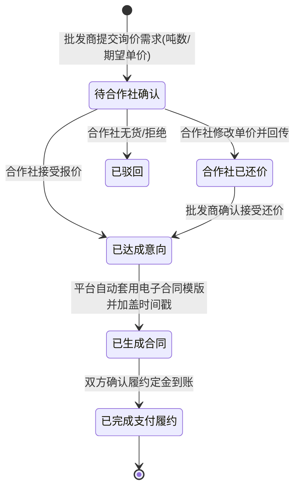

# “不烧心”农产品直播电商产销对接平台 - 软件实现与技术选型报告

**项目名称**：基于 SpringBoot+Vue 的“不烧心”农产品直播电商产销对接平台  
**品牌标语**：好产品，不烧心  
**课程名称**：软件工程导论课程设计  
**文档版本**：V2.0  
**编制日期**：2026年11月  

---

## 1. 开发语言与技术栈选型依据 (Language & Technology Selection)

### 1.1 后端开发语言选择：Java 21 vs 其他备选语言
在现代企业级软件工程与大型高可靠电子商务系统构建中，开发语言的稳定性、生态繁荣度、类型安全性与高并发处理能力至关重要。

| 选型维度 | Java (JDK 21 LTS) [本工程选用] | Python (FastAPI/Django) | Go (Golang) |
| :--- | :--- | :--- | :--- |
| **类型安全性与规范性** | 强静态类型系统，大型工程可维护性极高，重构风险小 | 动态弱类型，易发生运行时类型隐式错误 | 静态强类型，简洁高效 |
| **企业级电商生态** | 拥有全球最成熟的电商中台生态（Spring 生态、MyBatis、分布式中间件） | 偏向于人工智能与轻量脚本，电商事务组件较松散 | 偏向云原生与微服务底层，业务复杂建模稍显单薄 |
| **高并发与底层性能** | Java 21 引入了虚拟线程（Project Loom），能以轻量协程方式支撑百万级 I/O 并发 | GIL 全局解释器锁限制多线程并发吞吐 | 原生 Goroutine，高并发极强 |
| **事务与金融安全** | Spring 声明式事务（`@Transactional`）与多级锁机制极其成熟，保障资金安全 | 复杂分布式事务链条调试成本较高 | 依赖手动编码处理错误和回滚 |
| **人才与文档储备** | 计算机与软件工程专业核心教学语言，工程文档与规范体系完善 | 上手快但大型工程规范欠缺 | 语法简练但业务框架不如 SpringBoot 成熟 |

**选择依据结论**：鉴于“不烧心”农产品电商涉及六类主体、高并发直播抢购、大宗资金结算、37款地标农品品控管理、统一购物车合并结算与复杂关系型事务，**Java 21 LTS + Spring Boot 3.x** 是保障高工程规范性、资金安全性与代码健壮性的最佳选择。

### 1.2 前端开发框架选择：Vue 3 + Vite vs React
- **渐进式框架与学习曲线**：Vue 3 采用模版语法，符合中国开发者习惯；Composition API（组合式 API）提供了极强的业务逻辑封装与复用能力；
- **仿淘宝电商高级交互的高度还原**：
  * **品牌心智与专属 Logo**：嵌入“不烧心”心形生态矢量 Logo 与“好产品，不烧心”专属口号；
  * **可爱卡通头像**：默认集成 DiceBear 现代矢量卡通插画体系（6大角色专属萌趣种子）；
  * **37款地标样品矩阵**：支持 6 大品类（水果、蔬菜、粮油、滋补、禽畜、水产）0 延迟实时过滤；
  * **统一独立购物车**：仿淘宝独立 Cart View，支持多选、动态小计、阶梯满减与底部吸底统一结算；
  * **全真直播间交互**：真实视频播放、悬浮小黄车、彩色爱心粒子飘升动效与实时弹幕互动；
- **极速构建体验**：基于 ES Modules 的 Vite 构建工具，秒级启动与生产打包（5秒内完成构建）。

### 1.3 持久化与缓存选型：MySQL 8.0 + H2 + MyBatis-Plus
- **强一致性关系型存储**：MySQL 8.0 / 内嵌 H2 提供成熟的 ACID 事务与行级悲观锁/乐观锁，满足合同生成与订单结算的严谨需求；
- **MyBatis-Plus 3.5.6 增强**：极大简化 CRUD 代码，内置通用分页、乐观锁插件与自动更新填充。

---

## 2. 核心架构与工程代码组织

### 2.1 后端工程分层架构 (`backend`)
```
backend/
├── src/main/java/com/agri/platform/
│   ├── common/                # 通用基础设施层
│   │   ├── Result.java        # 统一 RESTful API 响应报文封装 (code, msg, data)
│   │   ├── Constants.java     # 业务常量定义
│   │   ├── exception/         # 全局业务异常与全局异常拦截器 (GlobalExceptionHandler)
│   │   └── security/          # Spring Security 过滤器、JWT 令牌解析器与上下文
│   ├── config/                # 核心配置类 (WebMvc跨域配置, MyBatisPlus分页插件, RedisTemplate)
│   ├── entity/                # 数据库实体类 (User, Product, OriginArchive, Order, Inquiry...)
│   ├── mapper/                # MyBatis-Plus 数据访问接口 (DAO)
│   ├── service/               # 业务接口与实现类 (Impl)
│   │   ├── UserService.java
│   │   ├── ProductService.java
│   │   ├── LiveRoomService.java
│   │   ├── WholesaleInquiryService.java
│   │   └── OrderService.java
│   └── controller/            # REST 控制器 (暴露 HTTP 端点)
│       ├── AuthController.java
│       ├── ProductController.java
│       ├── LiveController.java
│       ├── WholesaleController.java
│       ├── OrderController.java
│       └── AdminController.java
└── src/main/resources/
    └── application.yml        # 核心配置文件 (端口、数据源、Redis、文件上传配额)
```

### 2.2 前端工程目录组织 (`frontend`)
```
frontend/
├── src/
│   ├── api/                   # Axios 异步网络请求封装与请求/响应拦截器
│   ├── assets/                # 仿淘宝图标、农产品高清直采展示图、Logo
│   ├── components/            # 高复用业务组件
│   │   ├── TaobaoHeader.vue   # 仿淘宝吸顶顶部搜索与多维导航栏
│   │   ├── ProductCard.vue    # 双列流体商品卡片 (含产地徽标与价格)
│   │   ├── LivePipWindow.vue  # 仿淘宝直播画中画悬浮窗
│   │   └── TraceModal.vue     # 农产品产地溯源与质检弹窗
│   ├── router/                # Vue-Router 路由守卫与鉴权
│   ├── store/                 # Pinia 状态管理 (用户登录态、购物车、当前直播信息)
│   └── views/                 # 五大核心角色与仿淘宝专区视图
│       ├── Home.vue           # 仿淘宝首页 (综合货架/直供轮播/热卖榜)
│       ├── LiveHall.vue       # 产地直播大厅与直播互动专区
│       ├── WholesaleMarket.vue# 采购批发商大宗采购与在线询价专区
│       ├── ProductDetail.vue  # 商品详情页 (产地档案/大宗阶梯价/零售下单)
│       ├── CooperativeDesk.vue# 种植合作社手机/电脑极速上架与库存工作台
│       ├── AnchorDesk.vue     # 产地主播带货选品与直播复盘中心
│       ├── AdminDashboard.vue # 平台运营管理与产销大数据中心
│       └── UserCenter.vue     # 个人中心 (订单追踪/物流/售后)
├── index.html
├── package.json
└── vite.config.js
```

---

## 3. 关键业务机制与核心技术实现剖析

### 3.1 仿淘宝视觉体系与沉浸式交互实现
1. **吸顶导航与搜索胶囊**：采用 CSS3 `position: sticky; top: 0; z-index: 100` 实现吸顶，结合 `#FF5000` 渐变搜索按钮，提供“搜产地、搜品类、搜大宗”的即时模糊检索；
2. **直播小窗画中画 (Picture-in-Picture) 联动机制**：
   - 当用户在直播间中点击主播正在推荐的农副产品并跳转至“产地详情”或“提交订单”时，全局事件总线唤醒 `LivePipWindow.vue` 组件；
   - 视频窗口平滑缩小至屏幕右下角，音频持续播报，实现“边看直播边核对产地质检、无缝下单”的极致体验。

### 3.2 种植合作社移动端极速上架与田间多媒体处理
- 为解决农村基层农户输入复杂的问题，前端构建两步向导式极简上架表单，支持手机相机即时拍照上传田间实拍图片与农残合格证；
- 服务端接收后进行安全格式校验并回填产地坐标（经纬度），自动在数据库中生成绑定商品与溯源档案。

### 3.3 大宗产销询价磋商状态机机制
大宗农副产品属于非标大宗交易，交易过程采用严谨的状态机流转控制：


### 3.4 高并发库存扣减与防超卖安全控制
秒杀抢购与大宗锁库采用“缓存预扣 + 数据库版本号乐观锁”双重安全防线：
```java
// 数据库更新SQL示意 (基于当前剩余库存大于0的乐观锁保障)
UPDATE tb_product 
SET stock = stock - #{buyQuantity}, version = version + 1 
WHERE id = #{productId} AND stock >= #{buyQuantity};
```
在并发极端场景下，若扣减受影响行数为 0，则自动判定并发排队失败并回滚提示买家，杜绝负库存产生。
