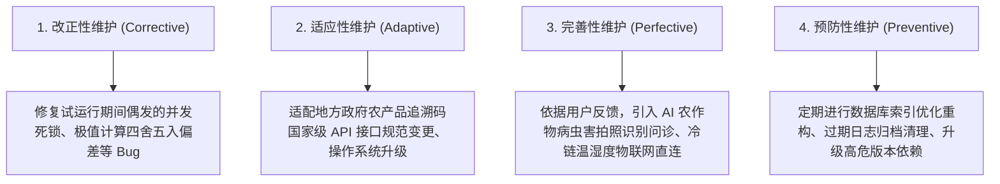

# “不烧心”农产品直播电商产销对接平台 - 软件运行与维护手册

**项目名称**：基于 SpringBoot+Vue 的“不烧心”农产品直播电商产销对接平台  
**品牌标语**：好产品，不烧心  
**课程名称**：软件工程导论课程设计  
**文档版本**：V2.0  
**编制日期**：2026年11月  

---

## 1. 系统运行环境配置规范

### 1.1 硬件与网络要求
- **服务器推荐配置**：
  - CPU：4 核及以上 (x86_64 / aarch64)
  - 内存：8GB RAM 及以上 (JVM 堆内存建议分配 `-Xms2g -Xmx4g`)
  - 存储空间：系统盘 50GB，数据盘 200GB (SSD 固态硬盘，用于存储田间实拍素材、37款地标农品样品素材与质检报告)
  - 网络带宽：上行带宽 ≥ 10Mbps (保证多路直播推拉流与高清大图并发访问流畅)
- **客户端要求**：
  - 计算机端：分辨率 1280×800 以上，支持现代 Chromium 内核浏览器 (Google Chrome 100+、Microsoft Edge、Firefox、Safari)
  - 移动设备端：支持 iOS 14+ / Android 10+ 移动浏览器，屏幕宽度自适应 360px~480px，支持淘宝移动双列与底部导航栏。

### 1.2 软件基础设施依赖版本

| 软件/组件 | 推荐版本 | 作用与职责 | 默认监听端口 |
| :--- | :--- | :--- | :---: |
| **操作系统** | Ubuntu 22.04 LTS / CentOS 8 / Windows 11 | 基础操作系统底座 | - |
| **Java 运行环境** | OpenJDK 21 LTS | 后端核心运行时 (支持虚拟线程) | - |
| **Node.js** | Node.js v20.x 或 v22.x (带 npm 10+) | 前端 Vite 工程构建环境 | - |
| **关系型数据库** | MySQL 8.0.x / 内嵌 H2 | 持久化核心业务数据 (37款地标农品与六大角色) | 3306 / 8080 |
| **Web 服务器/网关**| Nginx 1.24+ / Vite Proxy | 前端静态资源托管、反向代理与 SSL 卸载 | 3000 / 80 |
| **后端应用服务** | Spring Boot 3.x 内嵌 Tomcat | 承载业务 REST API 与 WebSocket | 8080 |

### 1.3 一键式启停运维脚本说明
为便于评审答辩与日常运维，工程根目录下提供了两个开箱即用的 Windows 批处理运维脚本：
- **`start.bat`**：一键双击自动拉起后端 Spring Boot 服务（端口 8080）与前端 Vite 开发服务（端口 3000），自动在浏览器中唤起主页；
- **`stop.bat`**：一键安全回收 8080 与 3000 端口占用的后台进程，避免残留占用系统资源。

---

## 2. 系统部署与启停标准操作程序 (SOP)

### 2.1 数据库与缓存初始化
1. **创建数据库**：
   连接 MySQL 8.0 服务端，执行建库命令：
   ```sql
   CREATE DATABASE IF NOT EXISTS agri_platform DEFAULT CHARACTER SET utf8mb4 COLLATE utf8mb4_unicode_ci;
   ```
2. **导入表结构与基础演示数据**：
   在命令行或 Navicat / DataGrip 中导入项目目录下的 `sql/schema.sql` 脚本文件：
   ```bash
   mysql -u root -p agri_platform < e:/软件开发/sql/schema.sql
   ```
3. **启动 Redis 缓存**：
   ```bash
   redis-server --daemonize yes
   ```

### 2.2 后端服务编译、配置与启动
1. **修改配置文件**：
   检查 `backend/src/main/resources/application.yml` 中的数据库账号密码及 Redis 端口配置：
   ```yaml
   spring:
     datasource:
       url: jdbc:mysql://localhost:3306/agri_platform?useUnicode=true&characterEncoding=utf8&serverTimezone=Asia/Shanghai
       username: root
       password: your_password
     data:
       redis:
         host: localhost
         port: 6379
   ```
2. **打包与运行**：
   在 `backend` 根目录下执行 Maven 打包构建：
   ```bash
   # 跳过单元测试快速打包
   mvn clean package -DskipTests
   
   # 启动后端应用
   java -jar -Xms1024m -Xmx2048m target/agri-platform-1.0.0.jar
   ```

### 2.3 前端构建与 Nginx 反向代理配置
1. **前端本地依赖安装与编译**：
   在 `frontend` 根目录下执行：
   ```bash
   npm install
   npm run build
   ```
   编译成功后将在 `frontend/dist` 目录下生成静态文件资源。
2. **Nginx 部署生产配置样例 (`nginx.conf`)**：
   ```nginx
   server {
       listen 80;
       server_name agri.example.com;

       # 前端静态页面托管
       location / {
           root /var/www/agri-frontend/dist;
           index index.html;
           try_files $uri $uri/ /index.html;
       }

       # 后端 RESTful API 反向代理
       location /api/ {
           proxy_pass http://127.0.0.1:8080/api/;
           proxy_set_header Host $host;
           proxy_set_header X-Real-IP $remote_addr;
           proxy_set_header X-Forwarded-For $proxy_add_x_forwarded_for;
       }

       # 直播间 WebSocket 实时通讯管道代理
       location /ws/ {
           proxy_pass http://127.0.0.1:8080/ws/;
           proxy_http_version 1.1;
           proxy_set_header Upgrade $http_upgrade;
           proxy_set_header Connection "Upgrade";
           proxy_read_timeout 3600s;
       }
   }
   ```

---

## 3. 日常监控、日志审计与数据备份

### 3.1 运行健康检查 (Health Check)
平台集成了 Spring Boot Actuator 健康端点：
- 查看服务存活状态：`GET http://localhost:8080/actuator/health`
- 查看系统性能指标：`GET http://localhost:8080/actuator/metrics`

### 3.2 结构化日志分析
系统日志统一输出至 `/var/log/agri-platform/` 目录：
- `app-info.log`：常规用户访问、大宗询价提交、订单下单业务流水；
- `app-error.log`：系统拦截的未受检异常、数据库死锁、支付超时等警报（自动按天切分归档保存 30 天）。

### 3.3 数据库自动化备份策略 (Disaster Recovery)
采用 Linux Crontab 定时调度 `mysqldump` 进行每日凌晨全量快照备份：
```bash
#!/bin/bash
# 每日凌晨 02:00 自动执行备份脚本 /scripts/backup_mysql.sh
BACKUP_DIR="/data/backup/mysql"
DATETIME=$(date +%Y%m%d_%H%M%S)
mkdir -p $BACKUP_DIR
mysqldump -u root -pYourPassword agri_platform | gzip > $BACKUP_DIR/agri_db_$DATETIME.sql.gz
# 自动清理 15 天以前的历史旧备份
find $BACKUP_DIR -name "*.sql.gz" -mtime +15 -exec rm -f {} \;
```

---

## 4. 常见系统故障诊断与排除速查表 (Troubleshooting)

| 故障现象 | 潜在根本原因 | 排查与解决步骤 (SOP) |
| :--- | :--- | :--- |
| **后端启动失败，报 `Address already in use: bind`** | 8080 端口被历史僵尸进程或其他应用占用 | Windows 下执行 `netstat -ano \| findstr 8080` 查询 PID，执行 `taskkill /F /PID <PID>` 终止占用进程；Linux 执行 `fuser -k 8080/tcp` |
| **前端请求后端报 403 Forbidden 或 CORS 错误** | 跨域安全配置未放行前端域名，或 JWT Token 缺失/过期 | 1. 检查前端 Axios `Authorization` 请求头是否带入 `Bearer <Token>`；<br>2. 检查 `WebMvcConfig` 中是否已配置 `allowedOriginPatterns("*")` |
| **直播间弹幕与商品推送无法连接 (WebSocket 报错)** | Nginx 代理未开启 HTTP/1.1 Upgrade 升级请求头 | 检查 Nginx 配置文件，确保包含 `proxy_set_header Upgrade $http_upgrade;` 与 `proxy_set_header Connection "Upgrade";` |
| **数据库提示 `Too many connections` 报错** | 突发高并发流量导致 HikariCP 连接池耗尽 | 检查 `application.yml` 中 `maximum-pool-size`，从默认 10 调大至 30~50；排查代码中是否存在未关闭的事务慢查询 |
| **图片上传失败，提示 `Maximum upload size exceeded`** | 上传的田间高清视频超过了 Spring 默认 1MB 阈值 | 修改 `application.yml` 中 `spring.servlet.multipart.max-file-size=50MB` 和 `max-request-size=100MB` |

---

## 5. 软件维护四类活动与二次开发演进指南

根据软件工程国家标准，本系统的后续维护主要围绕以下四大维护形态开展：



### 5.1 二次开发与功能扩展规范
1. **代码开发规范**：遵循阿里巴巴 Java 开发手册，类名大驼峰，方法与变量名小驼峰，金额计算一律使用 `BigDecimal` 禁止直接使用 `double`；
2. **前后端接口协议规范**：新增接口必须统一遵循 RESTful 风格，返回类型统一封装为 `Result<T>`，错误状态码在 `ResultCodeEnum` 中集中枚举；
3. **版本演进分支管理**：严格遵循 Git-Flow 工作流，`main` 分支保持稳定发版状态，特性开发在 `feature/*` 分支独立完成并通过单元测试验证后合并。
